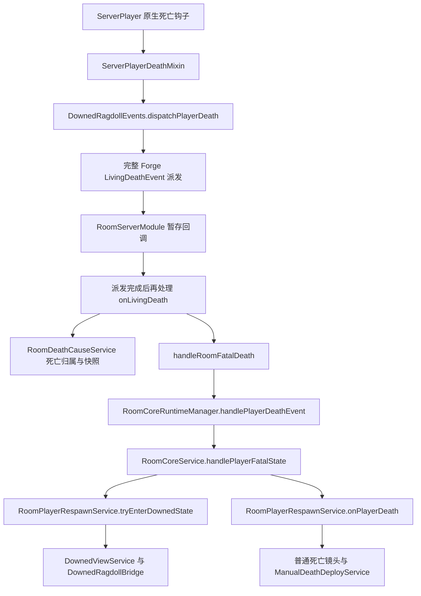
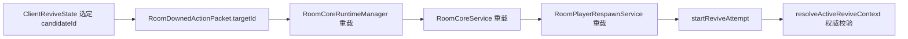

# 第一批迁移：核心入口、依赖与实施边界

本文与自动证据为 P1 迁移前的依赖分析快照。P1-A 的 `0.0.1` 和 P1-B 死亡派发/部署保护的 `0.0.2` 主 JAR 均已构建成功；最新实施范围见 [迁移版本记录](versions.md)。原始项目运行基线由用户确认，未重复验证。本文历史候选数及缺失接口数不代表迁移后的当前状态。

来源：最终反编译提交 `955b76d8adc264703eb49141bdb99b06e84cba46`、现有 ASM 的 prepare/patch/transplant 接入和原始源码工作区。目标盘点时 HEAD 为 `e66bf3eab69fbbe51b22748335e6f8bab91d8bfb`。证据见 [逐方法与静态依赖记录](p1-dependency-evidence.md)、[机器记录](p1-dependency-evidence.json) 和 [ASM 接入](asm-hooks.md)。

## 结论与范围

P1 不能通过整体复制六个核心类完成。六个起点保守追踪到 **87 个整类静态依赖候选（目标已有 22 个、缺少 65 个）**，包含死亡原因、镜头、手动部署、出界查询和配置类型；NetworkManager 的最终注册入口也把后续功能数据包拉进依赖链。

这个数量只描述当前最终源码中 imports、全限定名和同包/通配导入类名形成的候选集合，不是编译器证明的最小依赖集合。反射、Mixin 配置、自动事件订阅和部分字段接收者调用另行核对。不能把 87 当作必须一次迁移的数量，也不能只迁入它们就认定运行接入完整。

本轮逐方法核对 **45 个入口，发现 13 个目标缺失的方法/重载**。首个实施提交限定为“明确救援目标 UUID”的六个已有文件；完整 P1 按下面的调用链逐步完成。

## 核心调用链

事件监听器取消或恢复生命、嵌套死亡、事件未进入 GD 房间等分支都要保留。外层返回“停止原版死亡流程”和 LivingDeathEvent 的取消状态含义不同。当前接管设计让其他监听器完整收到事件，再决定 GD 是否接管，不能提前通过取消事件实现倒地。

显式救援请求链为：

`tryHandlePlayerDownedDamage` 是需要保留的新接口，但在当前 GD Java 源码树中只发现 Core 定义和 Manager 转发，未发现其他生产调用。当前主要死亡链实际走 `handlePlayerDeathEvent → handlePlayerFatalState`。不要为了使用新增接口重新引入致命伤害前置接管，改变已修复的事件顺序。反射或外部调用仍需另外考虑。

## 六个核心类逐方法迁移

路径均相对于 `org/mods/gd656conquest/`，迁入目标 `src/main/java/`。源码行位置在自动证据中；实际行为还要与 ASM 对照。

| 原类/方法 | 必须处理的依赖与行为 | 实施归属 |
| --- | --- | --- |
| RoomCoreRuntimeManager.handleDownedAction | 新增 UUID 重载；旧重载传 null；保留 coreService 为空返回 false；转发到 Core | P1-A |
| RoomCoreService.handleDownedAction | UUID 沿房间运行槽转发到 Respawn；保留找不到运行房间返回 false | P1-A |
| RoomPlayerRespawnService.handleDownedAction / startReviveAttempt | UUID 传入权威校验；null 保留最近目标回退；明确 UUID 无效时直接失败，不能偷偷改救援另一人 | P1-A |
| ClientReviveState.tick | 使用当前已选定 candidateId 构造 reviveStart 请求；后续停止/切换目标逻辑保留 | P1-A |
| RoomCoreRuntimeManager.tryHandlePlayerDownedDamage | 新接口转发，保留 coreService 空值分支 | P1-B/P1-D |
| RoomCoreService.tryHandlePlayerDownedDamage | 运行中、成员、倒地开启、部署/重新部署/出界待死亡条件，以及 UnifiedBoundaryService.isOutside | P1-D |
| RoomCoreService.handlePlayerFatalState | RoomDeathCauseService.consumeBoundaryDeath；原炮击中断、爬行清理、通知、阵营变更和玩法记账保留 | P1-B/P1-D |
| RoomServerModule.onLivingDeath | deferRoomDeath → resolveKiller → handleRoomFatalDeath → onRoomDeath；DamageSource 必须贯穿；非玩家事件保持原分支 | P1-B/P1-D |
| RoomServerModule.onServerTick / onServerStopped / onPlayerLogout / onPlayerChangedDimension | Bridge、View、DeathCause 的更新和清理；原 Manager tick 与退出处理保持；避免重复注册/重复 tick | P1-B/P1-C/P1-D |
| RoomPlayerRespawnService.tryEnterDownedState / activateDownedState | skipDowned；markPlayerDowned 后创建 View 会话和身体，再同步客户端；两个入口都要接入 | P1-B/P1-C/P1-D |
| RoomPlayerRespawnService.finishDownedState / skipDownedStateForRedeploy | 先计算共享部署延迟，在正确位置结束镜头与身体；保留跳过救援和阵亡状态转移 | P1-B/P1-C |
| RoomPlayerRespawnService.completeRevive | prepareRevive → stop(player,true) → 后续复活/姿态广播 → completeRevive；只移除成功救援的旧失明调用 | P1-C |
| RoomPlayerRespawnService.forceRedeployDeath | 首次存活判断保留；伤害/kill 后两处判断用 isStillAliveOutsideDeployment，防止二次杀死部署代理 | P1-B |
| RoomPlayerRespawnService.resolveActiveReviveContext / buildNearbyRescuerEntries / resolveNearestDownedRescueHint | 三处服务端距离从玩家实体位置改成身体位置；房间/队伍/救援资格与锁定条件保留 | P1-B/P1-C |
| RoomPlayerRespawnService.onPlayerDeath / openManualDeathDeploy / tick | 普通死亡开始镜头、共享死亡快照和手动部署；不能只复制 onPlayerDeath 而漏掉等待/请求/打开部署接口 | P1-D |
| RoomPlayerRespawnService.sendDownedStart / sendDownedUpdate | 旧同步后追加 DownedDeployService.publish；需要 downedDeployDelay 真实接口及当前死亡 ID | P1-D |
| RoomPlayerStateService.normalizePlayerModelState / applyDownedState | 标准化时结束镜头/身体；每个倒地 return 前 maintainProxy；原输入、物理、姿态约束保留 | P1-B/P1-C |
| ClientReviveState.resolveCandidateTarget | 身体/倒地标记和身体距离；与 ClientHooks 最终实现核对，不能只看旧源码的预览判断 | P1-B/P1-C |

RoomPlayerRespawnService 的 onPlayerDeath 在 ASM 中最终被 transplant 覆盖。不能把前面给旧方法插入的 startDeath 与最终移植方法里的 startDeath 再累加一次。以最终方法体和成品验收为准。

## 目标缺少的接口

这里列的是方法/重载，不包含包新增字段、构造器和所有新类的成员。参数名只为说明，类型/顺序按来源确认。

| 类 | 缺失接口 | 来源及用途 |
| --- | --- | --- |
| RoomCoreRuntimeManager | `handleDownedAction(ServerPlayer,String,UUID,long)` | 明确救援目标，转发 |
| RoomCoreService | `handleDownedAction(ServerPlayer,String,UUID,long)` | 明确救援目标，找到运行槽 |
| RoomPlayerRespawnService | `handleDownedAction(RoomDefinition,RunningRuntimeState,ServerPlayer,String,UUID,long)` | 动作处理与救援目标传递 |
| RoomPlayerRespawnService | `startReviveAttempt(RoomDefinition,RunningRuntimeState,ServerPlayer,UUID,long)` | 私有救援方法新签名 |
| RoomDownedActionPacket | `reviveStart(UUID)` | 客户端显式选择目标 |
| RoomCoreRuntimeManager | `tryHandlePlayerDownedDamage(ServerPlayer,RoomPosition,int,long)` | 新倒地资格 API 转发 |
| RoomCoreService | `tryHandlePlayerDownedDamage(ServerPlayer,RoomPosition,int,long)` | 新倒地资格 API |
| RoomPlayerRespawnService | `openManualDeathDeploy(RoomDefinition,RunningRuntimeState,ServerPlayer,long,int)` | ManualDeathDeployService.request 调用 |
| RoomPlayerRespawnService | `downedDeployDelay(RoomDefinition,RunningRuntimeState,UUID,long)` | DownedDeployService.publish 复用原延迟计算 |
| ClientDownedState | `killerCardRemainingTicks()` | 面板计时读取 |
| ClientDownedState | `requestReadyDeployment()` | 已就绪后的单次部署操作 |
| ClientDeathFlowState | `adoptCameraPose(double,double,double,float,float)` | 镜头向部署状态交接 |
| ClientDeathFlowState | `deathFilterKillerId()` | 死亡观察阶段的击杀者轮廓目标 |

旧构建通过 prepare 临时添加部分接口。源码迁移必须实现真实方法；占位 return false/return/固定 -1 不能当作完成实现。

DownedReviveRequest 的 ThreadLocal 用于让旧二进制的无 UUID 方法签名读取新目标。新源码能直接传 UUID，建议救援链保留旧重载作为 null 兼容入口，移除对此编译桥的需要。此决定只针对救援目标桥：Events 的事件上下文、Bridge 的致命动量和 DeathCause 的归属上下文有独立生命周期作用，不能一起删除。

## 必须一起处理的业务依赖

下表描述最终 P1 使用的真实依赖。完整功能可跨提交逐步启用；在相关调用接入的那个提交中，依赖必须存在且实现完整。

| 依赖组 | 直接触发点 | 必要类/接口与原因 |
| --- | --- | --- |
| 身体生命周期 | tryEnter/activateDowned、applyDownedState、finish/skip/normalize、退出 | DownedRagdollBridge / Events、DownedRagdollStatePacket、ClientDownedRagdollState / ClientHooks；生成/位置/代理/清理 |
| 动量与同步可靠性 | Bridge.start/withFatalSource、尸体转存、客户端替换/播放、观察范围 | RagdollHitCacheGuard、RagdollRecordView、RagdollSyncScope、RagdollPacketScope、RagdollSubscriptions / Policy、ClientRagdollSubscriptions、RagdollPlaybackGuard、RagdollVisibilityMath；相应 Mixin 与目录/观察/订阅包 |
| 镜头与救起姿态 | Bridge 与 Respawn 调用 View；客户端状态调用 Camera | DownedViewService / CameraConfig、DownedCameraMode、DownedViewPacket、ClientDownedCamera / Math / Accessor、RevivedPronePose、RevivedProneReleasePacket；相机所有权和安全趴姿回位 |
| 镜头关联状态 | ClientDownedCamera.accept/交接/清理 | ClientDeathFlowState、ClientDownedState、ClientDeathCauseState、ClientKillerCardState、ReviveTransition；最终源码的真实依赖 |
| 死亡快照和原因 | Events.dispatchPlayerDeath/handleRoomFatalDeath；Module.resolveKiller；Respawn.skipDowned；View.publish | RoomDeathCauseService、DeathCause / Classifier、KilliconFireOwnership、DeathCausePacket；死亡 ID、归属、强制死亡和界外救援资格 |
| 击杀元数据 | DeathCause.resolveKiller/capture/publish；Events.withFatalSnapshot | KillerIntelService、FatalHitMetadata、KillWeaponResolver、MatchDuelStats、KillerCardInfo / Packet；派发前快照与派发后的来源一致 |
| 普通死亡手动部署 | onPlayerDeath、handleDownedAction、tick | ManualDeathDeployService / Model、openManualDeathDeploy、DownedDeployPacket；等待、ready 门槛、倍增延迟和单次请求 |
| 倒地部署快照 | sendDownedStart/sendDownedUpdate | DownedDeployService、downedDeployDelay、ClientDownedDeployState / Model；客户端倒计时和操作门槛 |
| 界外死亡资格 | Core.tryHandlePlayerDownedDamage、DeathCause.withFireOwnership/resolveKiller | UnifiedBoundaryService.isOutside、FlightBoundaryGeometry、RoomCommonConfig 扩展字段；纯查询与 process/kill/载具处罚启用分开核对 |
| 载具强制死亡上下文 | DeathCause.tick/clear；UnifiedBoundaryService 其他方法 | BoundaryVehicleDestruction 与原生回调；纳入代码依赖不表示载具处罚/乘员逻辑已接入 |
| 公共配置类型 | RoomDefinition.commonConfig 及边界/回血/压制类型 | RoomCommonConfig、RoomSuppressionConfig、RoomNaturalRegenConfig；整类复制可能拉入后续类型，不表示补给/压制业务已迁移 |
| 全量网络注册 | NetworkManager.init → DownedRagdollNetwork.register | 十个扩展数据包及对应处理类；首次 UUID 提交只改旧包和阶段协议，全量注册按后续集成提交处理 |

RunningRuntimeState 本身不在原版到最终版的 Java 改动清单中。本轮复用已有的倒地、救援、部署状态容器，检查调用契约；没有理由为这些功能整体替换它。

## 静态图以外的加载和注入

- ServerPlayerDeathMixin 是死亡派发接管入口；只复制 Events 类不会自动改变 ServerPlayer 的死亡钩子。旧实现显式 SRG target/remap=false，本工程要转换为适配 official 开发与生产重混淆的写法。
- ragdoll 服务端：RagdollDeathMomentumMixin、ServerRagdollHitCacheMixin、RagdollPacketScopeMixin、RagdollSubscriptionMixin。客户端：ClientRagdollHitCacheMixin、RagdollSpawnMomentumMixin、ClientRagdollReplacementMixin、RagdollPlaybackMixin、RagdollVisibilityMixin。它们通过 Mixin 配置加载，不一定出现在核心 Java 图中。
- 引入镜头/趴姿时同时核对 DownedCameraAccessor、RevivedProneCrawlMixin、RevivedProneInputMixin、RevivedProneReleaseMixin；滤镜渲染、聊天及载具 native 回调按相应批次接入。
- 精确管理员杀死分类需要 KillCommandMixin 上下文。加入 RoomDeathCauseService 并不自动提供这个上下文。
- Gd656conquest 构造器要在合法 Java 位置注册 DownedCameraConfig。保留原注册顺序，不照搬 ASM 插在 `<init>` 起点的指令位置。
- RagdollSubscriptions 与客户端订阅/状态类的自动事件订阅要核对 tick 和清理，客户端类只在客户端加载；不能把自动订阅和手工 tick 叠加两次。
- Bridge / ClientDownedRagdollState / Subscriptions 通过反射调用 ragdollified，不被静态扫描计入；需核对固定前置 JAR 的服务端 API、RetainedRagdoll、包编码及客户端 manager/camera 接口。
- 外部 ragdoll 类既有反射访问，也有 Mixin 中的直接 import。编译依赖与生产可选依赖都要处理；@Pseudo 不代替缺依赖的专用服务器类加载验证。

## 首轮实施范围：P1-A 明确救援目标（0.0.1 已构建）

独立可验收行为：客户端选定玩家 A 时，服务端校验并开始救援 A；不传目标时仍走原来的最近合法目标回退。阶段内继续使用原工程现有的倒地身体/位置规则，身体位置替换在 P1-B/P1-C 完成。

以下路径相对于目标 `src/main/java/org/mods/gd656conquest/`。

| 文件 | 本提交修改范围 |
| --- | --- |
| network/packet/RoomDownedActionPacket.java | targetId 字段、UUID 构造器及 reviveStart(UUID)；encode/decode 为 action + 是否有目标 + 可选 UUID；handle 转发 UUID |
| server/room/entry/RoomCoreRuntimeManager.java | UUID 重载，旧重载传 null，直接转发 Core |
| server/room/core/RoomCoreService.java | UUID 重载，旧重载传 null，通过原运行槽转发 Respawn |
| server/room/runtime/RoomPlayerRespawnService.java | UUID 动作重载与 startReviveAttempt 参数；明确目标权威校验；保留 null 回退；不搬入整个最终 Respawn 方法集合 |
| client/room/ClientReviveState.java | tick 的 reviveStart 携带 candidateId；此提交不引入 Body/Camera/DeathCause 引用 |
| network/NetworkManager.java | 设置明确的迁移阶段协议，拒绝 098；完成格式/行为核对前不声称兼容最终 114 |
| server/room/runtime/ReviveTargetSelection.java（新增） | 独立目标选择策略：明确请求禁止替换、无目标才查询最近候选、统一调用权威校验 |

本轮未使用 DownedReviveRequest、prepared API JAR 或 ASM 方法注入，也未注册全部十个扩展包。阶段协议已设置为 `bf1-0.0.1`；两端必须同时使用匹配协议。

本轮成功条件为主 JAR 构建成功，已经满足。以下为实现核对和后续可补充的运行验证，不能将尚未实测的场景记为实机通过：

- [x] 新旧 Java 重载均存在且全源码编译通过；无目标的 surrender/revive_stop/redeploy 原分支保留。
- [ ] 有/无 UUID 网络编码往返；服务器方向、sender 空值和 enqueueWork 保留。
- [x] 独立目标选择验证：指定目标优先、明确无效目标不替换、无目标回退、权威拒绝及无候选五个场景通过。
- [ ] 不同房间/阵营、不存活、非倒地、距离越界或已经被救援的目标按原权威规则拒绝。
- [ ] 目标切换和停止救援保持一致；客户端不能通过自报 UUID 绕过服务端限制。
- [ ] 098 客户端不能与新包格式连接；专用服务器编译与运行路径不引入客户端类。

## 完整 P1 后续提交顺序

| 阶段 | 可验收结果 | 接入范围 |
| --- | --- | --- |
| P1-A | 已构建 0.0.1：请求 UUID 与服务端救援目标一致 | 上述六文件 + 独立目标选择类 |
| P1-B 死亡派发部分 | 已构建 0.0.2：完整事件后接管与强制部署保护 | 新 DeferredDeathDispatch/RoomDeathEventDispatcher/RagdollNetworkPresence/Mixin；原 Module/Respawn 必要接入，无身体功能启用 |
| P1-B | 完整死亡事件派发、单个身体、代理物理、距离/动量与同步清理 | Events、Bridge、ServerPlayerDeathMixin、网络/客户端 Body 状态、ragdoll 外部 Mixin、Core/Module/State/Respawn 接入；所需 View/Cause 真实依赖同时迁入 |
| P1-C | 镜头所有权与成功救起、趴姿/朝向归位正确 | View/Camera、客户端接口和 TACZ 趴姿联动；按 mark/prepare/stop/broadcast/complete 顺序验证 |
| P1-D | 原因/界外资格、普通死亡手动部署与倒地快照一致 | Cause/Killer 元数据、边界查询、Manual/DownedDeploy、共享包/接口；检查新 tryHandle API 与主死亡入口 |
| P1-E | 两端调用链和生命周期合并完成 | 退出/维度/停服/重新部署、全量包 ID/格式、配置注册、缺依赖分支、自动验证与多人验收 |

P1-B 的身体与镜头类存在双向调用，接入前需要把真实依赖同时带入编译；P1-C/P1-D 表示重点验收阶段，不表示可以在 P1-B 放空实现代替它们。相关行为已启用时在该次提交一并验证，不推迟到后续标签。

## 源码与成品差异处理

本轮词法定位发现来源 RoomPlayerRespawnService.buildNearbyRescuerEntries 的局部 Candidate record 被反编译成带字节码注释的非法声明，方法体无法正常闭合解析；证据标记 next-declaration-fallback。处理时保留原始源码完整的集合构造/返回实现，只按 ASM 将距离调用改为 Bridge.distanceSquared；不要覆盖成反编译方法体。其他丢失方法体、乱码和手工生成的 record equals/hashCode/toString 同样按原始源码结构保留。

依赖分析阶段完成入口定位，实施阶段已完成 P1-A 并构建主 JAR，未执行游戏验证。自动证据保持迁移前快照；`python tools/migration_p1_dependencies.py` 会按当前目标重建，因此后续若运行需标明目标状态，不覆盖本人工文档。
